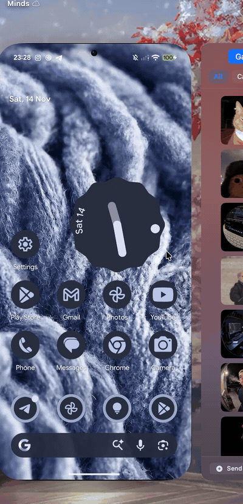
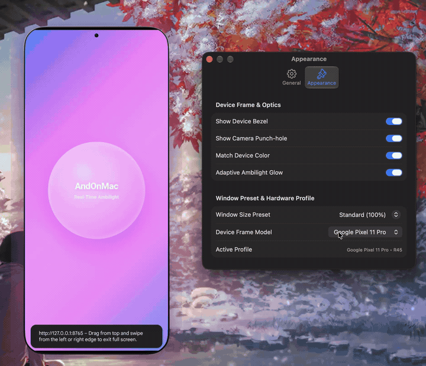
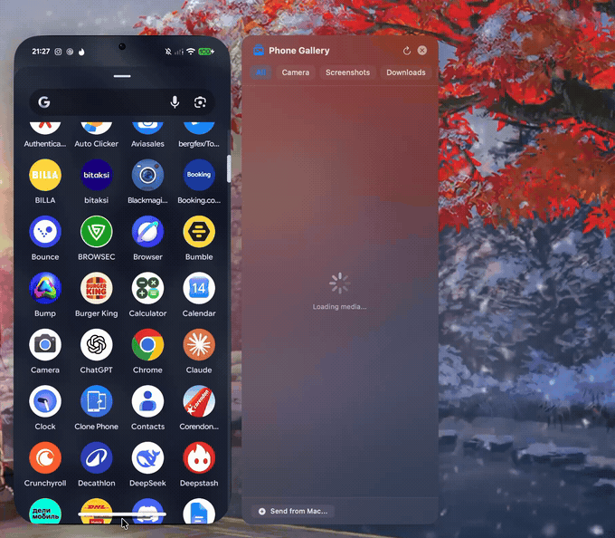
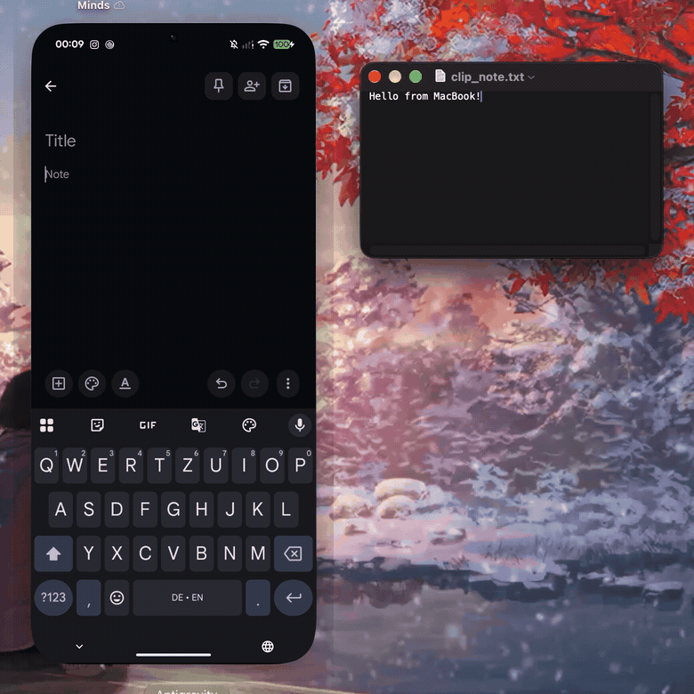
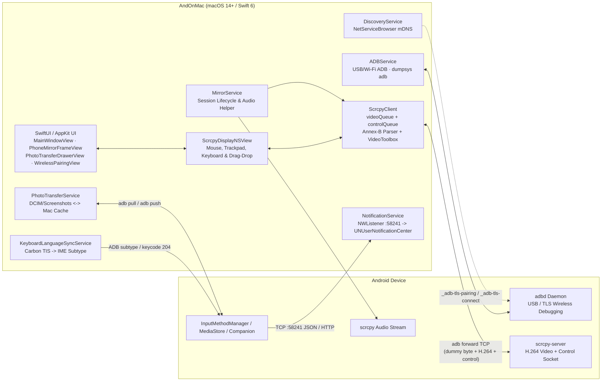

# AndOnMac

A native SwiftUI & VideoToolbox macOS application for mirroring, controlling, and transferring media with your Android smartphone at 60 FPS — with zero Electron bloat.

[](./LICENSE)
[](https://github.com/V0val0x/AndOnMac)
[](https://github.com/V0val0x/AndOnMac/releases)
[](https://github.com/V0val0x/AndOnMac/actions/workflows/ci.yml)
[](https://ko-fi.com/kirillzaitsev)

**English** | [Русская версия (Russian)](README_RU.md)



### Feature Demos

| 60 FPS Mirroring & Hover HUD | Vector Device Frames & Live Ambilight |
| :---: | :---: |
|  |  |

| Gallery Drawer & Drag-and-Drop (`Cmd+4`) | Universal Clipboard Sync (`macOS ↔ Android`) |
| :---: | :---: |
|  |  |

---

## Why AndOnMac?

| Capability | **AndOnMac** | Android File Transfer | OpenMTP | MacDroid | KDE Connect |
| :--- | :---: | :---: | :---: | :---: | :---: |
| **Native macOS UI (SwiftUI / AppKit)** | Yes (Swift 6) | Legacy | Electron | Native (Paid) | Qt |
| **Live 60 FPS Screen Mirroring (VideoToolbox)** | Yes | No | No | No | No |
| **Full Trackpad, Scroll & Keyboard Control** | Yes | No | No | No | Partial |
| **Bidirectional Photo & File Drag-and-Drop** | Yes (`Cmd+4`) | Broken / Legacy | File browser only | Paid | File send |
| **Device Audio Forwarding to Mac** | Yes | No | No | No | No |
| **macOS ↔ Android Keyboard Layout Sync** | Yes | No | No | No | No |
| **macOS Notification Center Integration** | Yes | No | No | No | Yes |
| **USB & Wireless Debugging (Bonjour mDNS)** | Yes | USB only | USB only | USB / Wi-Fi | Wi-Fi only |
| **Open-Source & Free (MIT)** | Yes | Proprietary | MIT | Proprietary | GPL |

---

## Features Implemented in This Codebase

- **Hardware-Accelerated 60 FPS Mirroring (`ScrcpyClient` + VideoToolbox):** Streams raw H.264 Annex-B frames from `scrcpy-server` over local ADB-forwarded TCP sockets and decodes them directly via `VTDecompressionSession` inside a frameless `NSView` (`ScrcpyDisplayNSView`) — no separate SDL video window in your Dock.
- **Programmatic Vector Device Frames & Ambilight (`DeviceFrameRenderer` + `AmbilightEngine`):** Fingerprints connected Android hardware (`ro.product.model` / `ro.product.vendor`) and renders resolution-independent vector bezels, calibrated camera cutouts, and Metal/CoreImage (`CIAreaAverage`) adaptive edge lighting for **Google Pixel 11 Pro / 11 / 10a / 8 / 9 / 10**, **Samsung Galaxy S24/S25 & Ultra**, **Xiaomi**, **Nothing Phone (2)**, and **OnePlus 12** — with a **Pro Display** rounded fallback for unknown models and customizable toggles in **Settings → Appearance**.
- **Native macOS Vibrancy & Fluid Spring Transitions:** Floating HUD capsules, overlays, pairing views, and the Menu Bar popover use adaptive `NSVisualEffectView` / `.ultraThinMaterial` surfaces, while window scale presets (`75% / 100% / 125%`) and portrait/landscape rotations animate with spring physics.
- **Bidirectional Photo & Media Drawer (`Cmd+4`, `PhotoTransferService`):** Pulls recent Camera photos and Screenshots from `/sdcard/DCIM` and `/sdcard/Pictures` for drag-and-drop into macOS apps/Finder, and pushes dropped images/APKs/files straight to `/sdcard/Download/`.
- **Real-Time Keyboard Layout Sync (`KeyboardLanguageSyncService`):** Observes macOS `TISNotifySelectedKeyboardInputSourceChanged` and switches Android `selected_input_method_subtype` / sends `KEYCODE_LANGUAGE_SWITCH`, with **Send on Enter** (`Shift+Return` for newline) for messengers.
- **Audio Forwarding (`MirrorService`):** Routes internal Android audio to Mac speakers via a hidden background `scrcpy` audio helper (`SDL_MAC_BACKGROUND_APP=1`).
- **USB & Wireless ADB Discovery (`ADBService` + `DiscoveryService`):** Supports 1-click USB-C mirroring, Android 11+ Wireless Debugging PIN pairing via Bonjour (`_adb-tls-pairing._tcp` / `_adb-tls-connect._tcp`), `dumpsys adb` `tls_port` extraction over USB, and saved device history.
- **macOS Notification Center Bridge (`NotificationService`):** Listens on TCP port `58241` for companion JSON notifications and QR discovery payloads, posting native `UNUserNotificationCenter` banners.

---

## Keyboard Shortcuts

| Shortcut | Action |
| :--- | :--- |
| `Cmd + 1` / Swipe up on Home bar | Home Screen (`KEYCODE_HOME`) |
| `Cmd + 2` / Swipe up and hold | App Switcher (`KEYCODE_APP_SWITCH`) |
| `Cmd + 3` | Notification Shade (`KEYCODE_NOTIFICATION`) |
| `Cmd + 4` | Toggle Photo & Media Transfer Drawer |
| `Cmd + Backspace` / `Esc` / Right-Click | Back |
| `Cmd + P` | Power / Lock / Wake Screen |
| `Cmd + 0` / `Cmd + +` / `Cmd + -` | Window Scale (100% / 125% / 75%) |
| `Cmd + Shift + R` | Reset ADB & Recover USB |
| `Cmd + W` | Stop Mirroring / Close Window |

---

## Installation & Quick Start

### Option 1: GitHub Releases (Recommended)
1. Download the latest `AndOnMac.dmg` from [**GitHub Releases**](https://github.com/V0val0x/AndOnMac/releases).
2. Open `AndOnMac.dmg` and drag **AndOnMac.app** to `/Applications`.
3. Connect your Android phone via USB-C (with **USB Debugging** enabled) or pair wirelessly via **Settings → Developer Options → Wireless Debugging**.

### Option 2: Homebrew Cask Formula
A ready-to-use Homebrew Cask definition is included at [`packaging/Casks/andonmac.rb`](./packaging/Casks/andonmac.rb):

```bash
brew install --cask ./packaging/Casks/andonmac.rb
```

### Option 3: Build from Source (macOS 14+, Swift 5.9+ / 6.x)
```bash
# 1. Install runtime tools (bundled automatically into the .app)
brew install scrcpy android-platform-tools

# 2. Run unit & integration tests
swift test

# 3. Build standalone dist/AndOnMac.app and dist/AndOnMac.dmg
chmod +x scripts/*.sh
./scripts/create_dmg.sh
```

---

## Architecture Overview

AndOnMac avoids heavyweight cross-platform runtimes by pairing a native **SwiftUI / AppKit** frontend with direct **VideoToolbox** H.264 decoding and **ADB / Bonjour** system services:



### Key Engineering Decisions
- **Separate `videoQueue` & `controlQueue`:** Decouples blocking control-message reads from raw Annex-B NAL parsing so the H.264 stream never stalls, while synchronized `VTDecompressionSession` teardown prevents lifecycle crashes.
- **Embedded `scrcpy-server` + Hidden Audio Helper:** Renders video natively inside SwiftUI/AppKit (`CGImage` backed by VideoToolbox) and delegates audio forwarding to a headless `scrcpy --no-video --no-control --no-window` child process with `SDL_MAC_BACKGROUND_APP=1` so the Dock stays clean.
- **Resilient Wireless Debugging Discovery:** Combines macOS Bonjour (`NetServiceBrowser`) with lossy UTF-8 parsing of `adb shell dumpsys adb` to extract active `tls_port` values even when Android's `ABX` binary keystore header is present.

---

## Support

If AndOnMac saves you time or makes working between macOS and Android smoother, you can leave a voluntary tip to support ongoing maintenance and testing:

[](https://ko-fi.com/kirillzaitsev)

*Contributions via Ko-fi are purely voluntary tips and do not include support SLAs, custom development commitments, or charitable tax deductions.*

---

## License & Legal Notices

MIT License © 2026 Kirill Zaitsev. See [LICENSE](./LICENSE).  
Screen mirroring and ADB transport bundle components from [Genymobile/scrcpy](https://github.com/Genymobile/scrcpy) and **Android Platform Tools (`adb`)** under the **Apache License 2.0**. Full attributions and license texts are provided in [THIRD_PARTY_NOTICES.md](./THIRD_PARTY_NOTICES.md) (also bundled inside `AndOnMac.app/Contents/Resources/`).

*AndOnMac is an independent open-source project and is not affiliated with, endorsed by, or sponsored by Apple Inc., Google LLC, Samsung Electronics, Xiaomi, Nothing Technology, or OnePlus. All product names and trademarks belong to their respective owners and are used strictly for compatibility identification.*
