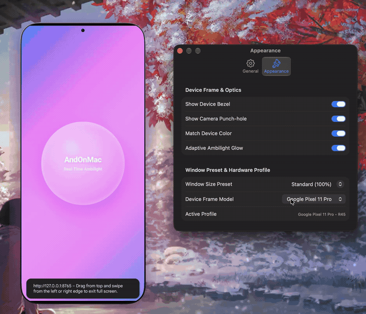
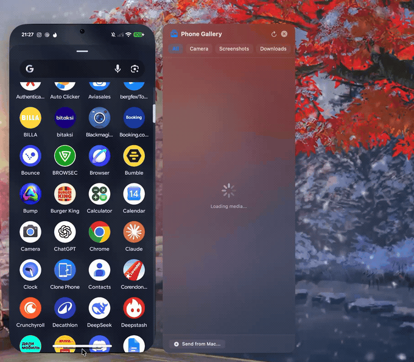
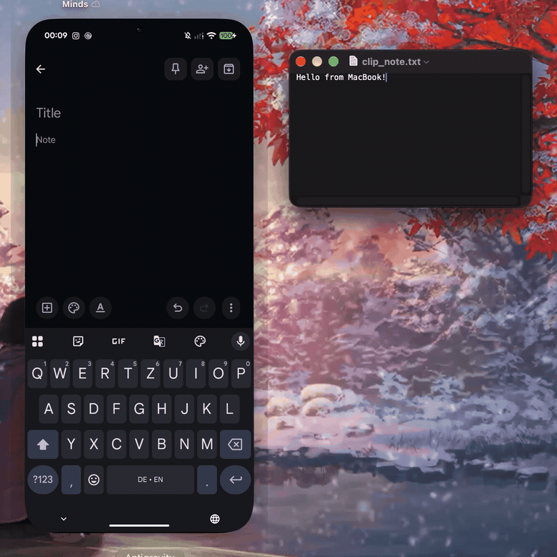

# AndOnMac 📱⚡️💻

<p align="center">
  
  
  
  
</p>

[English Version](README.md) | **Русская версия**

> **Нативный open-source аналог Apple iPhone Mirroring для Android и Google Pixel на macOS.**

Бесплатное нативное приложение на SwiftUI и VideoToolbox для зеркалирования экрана Android-смартфона на 60 FPS, плавного управления с трекпада и клавиатуры, двустороннего переноса фото и файлов, общего буфера обмена и трансляции звука — без Electron и лишнего веса.


### Демонстрация возможностей

| Трансляция 60 FPS и Hover HUD | Рамки устройств и живой Ambilight |
| :---: | :---: |
|  |  |

| Галерея и перенос фото на Mac (`Cmd+4`) | Общий буфер обмена (`macOS ↔ Android`) |
| :---: | :---: |
|  |  |

---

## ✨ Ключевые возможности

* ⚡️ **120Hz ProMotion и Apple Silicon**: аппаратное ускорение `HEVC` (`--max-fps=120`, 16 Мбит/с) с автопереходом на `H.264`, zero-copy рендеринг через `CAMetalLayer` + `CVMetalTextureCache` + `120Hz CADisplayLink`, приоритет macOS `latencyCritical`, адаптивный битрейт (ABR) по RTT/jitter и отключаемый **Metal Performance HUD**.
* 📱 **Программные векторные рамки и Ambilight (`DeviceFrameRenderer` + `AmbilightEngine`)**: точное определение модели и вендора устройства (`ro.product.model` / `ro.product.vendor`), векторные безели, калиброванный вырез камеры и адаптивное фоновое свечение через Metal `CoreImage` (`CIAreaAverage`) для **Google Pixel 11 Pro / 11 / 10a / 8 / 9 / 10**, **Samsung Galaxy S24/S25 и Ultra**, **Xiaomi**, **Nothing Phone (2)**, **OnePlus 12**, а также универсальная рамка **Pro Display** и вкладка настроек **Оформление**.
* 🪟 **Нативный macOS Vibrancy и пружинные анимации**: полупрозрачные панели (`NSVisualEffectView` / `.ultraThinMaterial`), поповер в строке меню и плавный ресайз по пресетам и при повороте экрана.
* 📲 **QR-сопряжение и автопереход USB → Wi-Fi**: нативное сопряжение Android 11+ по QR-коду (`NWListener` + `_adb-tls-pairing._tcp` Bonjour + `CoreImage`), тихий перевод USB → `adb tcpip 5555` и автопереподключение после сна Mac.
* 📡 **Обход изоляции роутера (Direct Hotspot и Bluetooth PAN)**: автоматически обнаруживает AP/Client Isolation в публичных/университетских/корпоративных Wi-Fi сетях и предлагает переключение в 1 клик на **Direct Hotspot** или **Bluetooth PAN** (`192.168.44.1:5555`).
* 🪟 **Отдельные окна для Android-приложений (Virtual Displays)**: поиск и запуск любых запускаемых приложений Android (как пользовательских, так и предустановленных/системных — например, YouTube, Chrome, Настройки) прямо из строки меню (**Запуск приложения Android**) в отдельном окне macOS (`scrcpy --new-display --start-app=...`) при выключенном экране телефона.
* 🖱 **Плавные жесты трекпада и смартфона**: инерция 1:1 для скролла, зума (pinch-to-zoom) и навигационных жестов Android — свайп с краёв (Назад), свайп снизу вверх (Домой / Недавние) и шторка уведомлений.
* 📋 **Фоновый Continuity Bridge (`macOS ↔ Android`)**: работает даже при закрытом окне зеркалирования — мгновенная двусторонняя синхронизация текста и **скопированных изображений/скриншотов** (`NSPasteboard` PNG/TIFF → `/sdcard/Pictures/AndOnMac/`).
* 🔍 **Локальный Apple Vision OCR (`Cmd+Shift+X`)**: нажмите `Cmd+Shift+X` или *«Распознать текст с экрана»*, выделите область на экране телефона и скопируйте любой невыделяемый текст в буфер обмена Mac через Neural Engine (`VNRecognizeTextRequest`).
* 🧠 **Semantic Screen Memory («Recall», `Cmd+Shift+F`)**: опциональная полностью локальная память экрана — раз в 10 секунд проверяет хеш кадра, при изменениях запускает Apple Silicon Vision OCR в `autoreleasepool`, сохраняет текст и сжатые миниатюры в SQLite **FTS5** (автоочистка через 7 дней / лимит 250 МБ) и открывает мгновенный поиск в стиле Spotlight по `Cmd+Shift+F`.
* 🖼 **Полноценная медиатека и перенос файлов (`Cmd+4`)**: просмотр всей галереи (Камера, Скриншоты, Загрузки, Видео), перетаскивание фото прямо на рабочий стол Mac или в приложения, а также загрузка файлов с Mac в `/sdcard/Download/`.
* ⌨️ **Удобный ввод и кириллица**: поддержка ввода кириллицы, отправка сообщений по `Enter` (`Shift+Return` для переноса строки) и вставка через `Cmd+V`.
* 🔊 **Передача звука и уведомлений**: системный звук смартфона играет через динамики Mac, а пуши приходят в Центр уведомлений macOS.
* 🧩 **Постоянная утилита в строке меню (Menu Bar)**: поповер в стиле Пункта управления с индикатором заряда и Wi-Fi/USB, переключателями в 1 клик (*Экран выкл.*, *Не засыпать*, *Звук*, *Запись экрана*), автообнаружением устройств по mDNS, профилями качества и режимом *Скрыть иконку из Dock*.
* 🌍 **Мультиязычный интерфейс (RU / EN)**: автоматически выбирает язык системы с возможностью переключения в настройках.

---

## 🤖 Управление ИИ-агентами (встроенный MCP-сервер)

AndOnMac включает встроенный **Model Context Protocol (MCP)** сервер без внешних зависимостей (`protocolVersion: "2024-11-05"`), позволяющий Claude Desktop, Cursor, Windsurf и локальным ИИ-агентам видеть экран и управлять Android-устройством с живым HUD-индикатором и кнопкой **Пауза / Отзыв агента** в строке меню.

### Настройка для Claude Desktop / Cursor (`stdio`)
Нажмите **Копировать MCP-конфиг** в строке меню AndOnMac или добавьте в `claude_desktop_config.json` / настройки MCP в Cursor:

```json
{
  "mcpServers": {
    "andonmac": {
      "command": "/Applications/AndOnMac.app/Contents/MacOS/AndOnMac",
      "args": ["--mcp-stdio"]
    }
  }
}
```

Также можно включить **AI Agent Bridge (MCP)** в строке меню для запуска локального HTTP/SSE сервера на `http://127.0.0.1:8765/sse`.

### Доступные MCP-инструменты
- `android_list_devices` · `android_get_ui_tree` (компактный XML→JSON с `center_x`/`center_y`) · `android_screenshot` (сжатый PNG)
- `android_tap_element` (по координатам или `text`/`resource_id`/`content_desc`) · `android_swipe` · `android_type_text` · `android_keyevent` · `android_launch_app` · `android_get_notifications`
- **Visual-to-MCP Bridge и самовосстанавливающиеся макросы (`Cmd+Shift+M` / строка меню → *Создать MCP Tool*):** заморозьте кадр для захвата одного элемента (`resource-id`/`class`/`text`) или включите **Записать макрос** для объединения цепочки шагов с динамическими `{{parameter}}`-переменными (например, `{{message_body}}`) и настраиваемыми в **Общих настройках** и для каждого инструмента паузами и лимитами. Поддерживает **3-уровневый Self-Healing** (если `resource-id` изменился после обновления приложения, AndOnMac находит нужную надпись через Apple Vision OCR, пишет в лог `"Semantic ID failed, healed via Vision OCR"`, уведомляет пользователя и точно нажимает на кнопку). Управляйте инструментами, настраивайте лимиты, экспортируйте и импортируйте JSON-схемы в **MCP Tool Hub** с мгновенным LiveReload (`notifications/tools/list_changed`).

---

## 🚀 Установка и быстрый старт

### Способ 1: Готовый установщик (Рекомендуется)
1. Скачайте последний релиз [**AndOnMac.dmg (GitHub Releases)**](https://github.com/V0val0x/AndOnMac/releases).
2. Откройте образ и перетащите **AndOnMac.app** в папку `Applications` («Программы»).
3. Подключите Android по USB-C (с включённой **Отладкой по USB**) или по Wi-Fi (*Параметры разработчика → Беспроводная отладка*).

> **Почему macOS предупреждает при запуске `.dmg`?**  
> **AndOnMac** — полностью бесплатный open-source проект без платного сертификата Apple Developer ID (\$99/год), поэтому Apple не нотаризирует `.dmg` автоматически. Чтобы разрешить запуск один раз:
> - **Быстрый способ (Терминал):**
>   ```bash
>   xattr -cr /Applications/AndOnMac.app
>   ```
> - **Через интерфейс (macOS Sequoia / Sonoma):** Попробуйте открыть `AndOnMac`, нажмите **Готово/Отмена**, затем перейдите в **Системные настройки → Конфиденциальность и безопасность → Всё равно открыть**.

### Способ 2: Homebrew Tap (Рекомендуется — без проблем с Gatekeeper)
Фирменный Homebrew Tap автоматически снимает карантин macOS (`xattr -cr`) при установке:
```bash
brew install --cask V0val0x/andonmac/andonmac
```

Обновление до новых версий:
```bash
brew upgrade --cask andonmac
```

### Способ 3: Сборка из исходников (macOS 14+, Swift 5.9+ / 6.x)
```bash
# 1. Установите зависимости (автоматически упаковываются в .app)
brew install scrcpy android-platform-tools

# 2. Запустите тесты
swift test

# 3. Соберите dist/AndOnMac.app и dist/AndOnMac.dmg
chmod +x scripts/*.sh
./scripts/build_app.sh && ./scripts/create_dmg.sh
```

---

## 🔒 Безопасность и приватность ADB

AndOnMac работает **полностью локально** между вашим Mac и смартфоном — без облачных серверов, аналитики и телеметрии:

* **Аппаратное подтверждение (RSA / TLS):** И USB-отладка, и беспроводная отладка Android 11+ (`_adb-tls-connect._tcp`) требуют явного подтверждения RSA-ключа вашего Mac на экране разблокированного телефона.
* **Защита от инъекций:** Серийные номера устройств и адреса `host:port` проходят строгую валидацию до вызова `adb`, а аргументы передаются массивом без запуска shell.
* **Защита от случайной потери данных:** Файловый менеджер блокирует path traversal (`..`), нулевые байты и удаление защищённых корневых папок (`/`, `/sdcard`, `/sdcard/DCIM`, `/sdcard/Download`, `/system`).
* **Контроль памяти и сетевых границ:** Локальный сервер уведомлений (`:58241`) отклоняет пакеты больше 64 КБ, видеопоток H.264 ограничен буфером в 16 МБ, а кэш фото автоматически очищается при превышении 200 МБ.

---

## ⌨️ Горячие клавиши

| Сочетание клавиш | Действие |
| :--- | :--- |
| `Cmd + 1` / Свайп вверх снизу | Домашний экран (`KEYCODE_HOME`) |
| `Cmd + 2` / Высокий свайп снизу | Недавние приложения (`KEYCODE_APP_SWITCH`) |
| `Cmd + 3` | Шторка уведомлений (`KEYCODE_NOTIFICATION`) |
| `Cmd + 4` | Открыть / скрыть медиатеку и перенос фото |
| `Cmd + Backspace` / `Esc` / ПКМ | Назад (Back) |
| `Cmd + P` | Блокировка / Включение экрана |
| `Cmd + 0` / `Cmd + +` / `Cmd + -` | Масштаб окна (100% / 125% / 75%) |
| `Cmd + Shift + R` | Сброс ADB и переподключение USB |
| `Cmd + W` | Остановить трансляцию / Закрыть окно |

---

## 🛠 Архитектура и стек

* **Frontend**: Swift 6.0, SwiftUI, AppKit (macOS 14.0+).
* **Видео и сеть**: Apple `VideoToolbox`, `Network.framework` (Bonjour mDNS / NWBrowser, TCP).
* **Ядро стриминга**: [scrcpy](https://github.com/Genymobile/scrcpy) (H.264 / Opus decoding).
* **Сборка**: GitHub Actions CI с автоматической проверкой и сборкой DMG.

---

## 📄 Лицензия

MIT License © 2026 Zaitcev Kirill.  
Ядро зеркалирования использует открытые компоненты Genymobile scrcpy (Apache 2.0).
