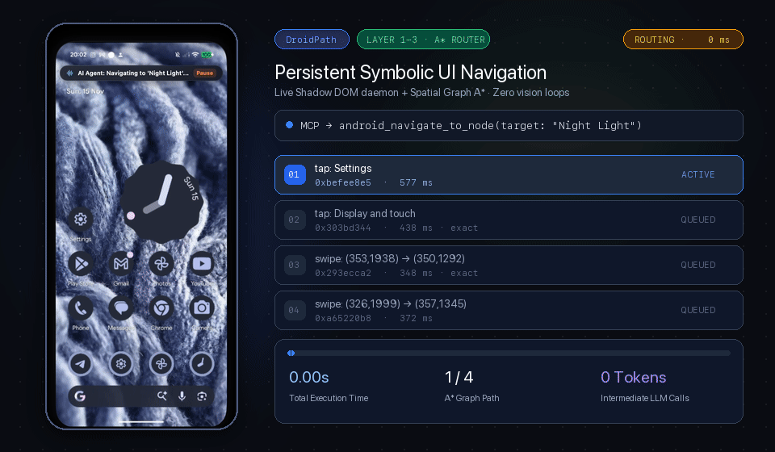
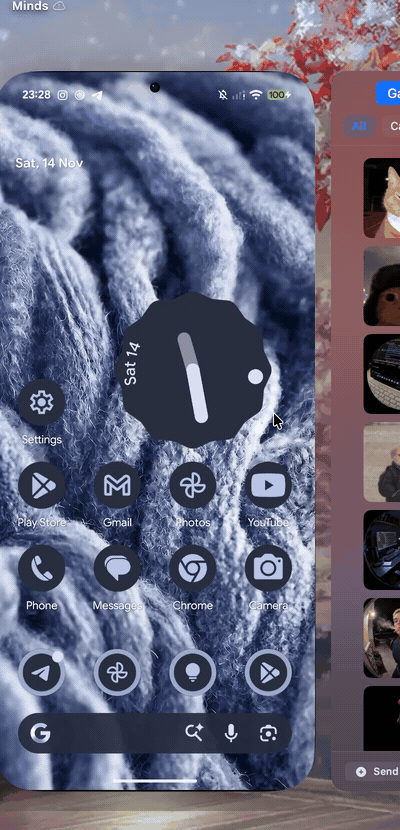

# AndOnMac

Нативное macOS-приложение (SwiftUI, VideoToolbox, Metal) для зеркалирования экрана, управления и обмена файлами с Android до **120 FPS (ProMotion)**.

[](./LICENSE)
[](https://github.com/V0val0x/AndOnMac)
[](https://github.com/V0val0x/AndOnMac/releases)
[](https://github.com/V0val0x/AndOnMac/actions/workflows/ci.yml)
[](https://ko-fi.com/kirillzaitsev)

[English](README.md) | **Русский** · [Подробная документация и архитектура](docs/FEATURES_RU.md)

| Персистентный A* UI-роутер ([DroidPath](https://github.com/V0val0x/DroidPath)) |
| :---: |
|  |

| Трансляция 120 FPS и жесты | Рамки устройств и Ambilight | Галерея и перенос фото (`Cmd+4`) | Общий буфер (`macOS ↔ Android`) |
| :---: | :---: | :---: | :---: |
|  |  |  |  |

## Возможности

- **120Hz Metal-движок:** аппаратное декодирование `HEVC` (с переходом на `H.264`), рендер через `CAMetalLayer` + `CADisplayLink`, адаптивный битрейт, передача звука на Mac и Performance HUD.
- **Подключение:** USB-C, QR/Bonjour Wi-Fi-сопряжение для Android 11+, тихий переход USB → Wi-Fi и обход изоляции роутера через Direct Hotspot / Bluetooth PAN.
- **Окна приложений и файлы:** запуск Android-приложений в отдельных окнах macOS, drag-and-drop фото (`Cmd+4`), файловый менеджер (`Cmd+5`) и синхронизация буфера обмена.
- **Vision OCR и Recall:** распознавание текста с экрана через Apple Vision (`Cmd+Shift+X`) и локальный поиск по истории экрана на SQLite FTS5 (`Cmd+Shift+F`).
- **Рамки и Ambilight:** векторные рамки с вырезами камер для Pixel, Galaxy S, Nothing Phone и OnePlus, подсветка краёв и жесты трекпада.
- **A*-роутинг и MCP ([DroidPath](https://github.com/V0val0x/DroidPath)):** Kotlin-демон `android-daemon` работает строго по loopback `127.0.0.1`, маскирует пароли (`isPassword -> "***"`), выполняет нативный ввод `tap`/`swipe`/`keyevent` через `UiAutomation` (с zero-fling 120Hz свайпами и авто-fallback на `adb`) и стримит Shadow DOM и события `FLAG_SECURE` по ADB TCP (`:27189`) в персистентный граф `shadow_graph.json` (с нормализацией часов, дат, цен `<PRICE>`, `<ETA>`, `<WEIGHT>`, карт по Луну `<CARD>`, кодов `<OTP>`, фильтрацией баннеров и маскированием `systemui`). `android_navigate_to_node` (с `auto_explore: true`) и `android_explore_and_click` строят A*-маршруты и достраивают граф на лету с forward-skip, размоткой стека `Back-to-Root`, `Smart Scroll-to-Selector`, деградацией и автоочисткой нестабильных рёбер (`consecutiveFailures`), автозакрытием попапов, Human-in-the-Loop подтверждением опасных шагов (`requires_confirmation` / `confirmed: true`), паузой на биометрии (`FLAG_SECURE`), трёхцветным 120Hz Agentic HUD (**Красный** — автономный шаг, **Жёлтый** — ожидание подтверждения, **Синий** — ожидание биометрии), записью макросов (`Cmd+Shift+M`) и встроенными правилами LLM (`.cursorrules`, `CLAUDE.md`, `GEMINI.md`, `docs/system_prompt.md`).

Настройка MCP, безопасность, все шорткаты и архитектура: [docs/FEATURES_RU.md](docs/FEATURES_RU.md).

## Comparison with Alternatives

Существующие решения используют stateless ADB-биндинги, что даёт 2–4 секунды задержки на каждое действие и заставляет LLM микроменеджить интерфейс. AndOnMac использует персистентный направленный ациклический граф (DAG) и A*-маршрутизацию на macOS, снижая latency до `<1s` на клик и полностью снимая нагрузку с LLM при навигации по известным маршрутам.

| Инструмент | Подход к автоматизации | Задержка на шаг | Нагрузка на LLM | Зеркалирование и HUD |
| :--- | :--- | :---: | :--- | :--- |
| **Mobile MCP / Maestro MCP / adbridge** | Stateless-обёртки над ADB / `uiautomator` | 2–4 с | LLM планирует каждый клик и свайп | Нет |
| **Appium / CursorTouch** | WebDriver-сессии или циклы по скриншотам | 2–5 с | Частые запросы к модели и опрос DOM | Внешнее / VNC |
| **AndOnMac + DroidPath** | Персистентный DAG + A*-роутер + Shadow DOM демон | `<1s` / шаг | `0` промежуточных вызовов на известных маршрутах | 120Hz Metal + живой HUD |

## Установка

### Homebrew (рекомендуется)
```bash
brew install --cask V0val0x/andonmac/andonmac
```
Обновление: `brew upgrade --cask andonmac`.

### Установщик `.dmg`
1. Скачайте `AndOnMac.dmg` со страницы [GitHub Releases](https://github.com/V0val0x/AndOnMac/releases).
2. Перетащите **AndOnMac.app** в `/Applications` и снимите карантин Gatekeeper (приложение без платной подписи Apple):
   ```bash
   xattr -cr /Applications/AndOnMac.app
   ```
3. Подключите Android по USB-C (**Отладка по USB**) или по Wi-Fi (**Беспроводная отладка**).

### Сборка из исходников (macOS 14+, Swift 5.9+)
```bash
brew install scrcpy android-platform-tools
swift test
chmod +x scripts/*.sh && ./scripts/create_dmg.sh
```

## Горячие клавиши

| Сочетание | Действие |
| :--- | :--- |
| `Cmd + 1` / `Cmd + 2` / `Cmd + 3` | Домой / Недавние / Шторка уведомлений |
| `Cmd + 4` / `Cmd + 5` | Галерея и перенос фото / Файловый менеджер |
| `Cmd + Shift + X` / `Cmd + Shift + F` | Apple Vision OCR / Поиск по истории экрана (Recall) |
| `Cmd + Shift + R` / `Cmd + W` | Сброс ADB и USB / Остановить трансляцию |

Полная таблица: [docs/FEATURES_RU.md](docs/FEATURES_RU.md#горячие-клавиши-и-жесты).

## Экосистема и связанные пакеты

Кроссплатформенный компаньон и отдельные Swift-пакеты (`macOS 14+`, MIT):

| Репозиторий | Назначение | Платформа / Подключение |
| :--- | :--- | :--- |
| [**DroidPath**](https://github.com/V0val0x/DroidPath) | Кроссплатформенный A* UI-роутер на Rust, Tauri v2 Desktop HUD, 1-клик CLI `npx droidpath` и Kotlin Shadow DOM демон (100% совместимость `shadow_graph.json` с AndOnMac) | Windows · Linux · macOS (`npx droidpath` / Rust / Tauri v2) |
| [**MetalScrcpyKit**](https://github.com/V0val0x/MetalScrcpyKit) | VideoToolbox H.264/HEVC декодер, рендерер на `CAMetalLayer` и ABR | `.package(url: "https://github.com/V0val0x/MetalScrcpyKit.git", from: "1.0.0")` |
| [**ADBConnectKit**](https://github.com/V0val0x/ADBConnectKit) | Swift ADB SDK: USB, QR Wi-Fi, Bonjour и обход изоляции (Hotspot / BT PAN) | `.package(url: "https://github.com/V0val0x/ADBConnectKit.git", from: "1.0.0")` |
| [**AndroidMCPKit**](https://github.com/V0val0x/AndroidMCPKit) | MCP-сервер (`stdio` / SSE), Visual-to-MCP макросы и CLI `android-mcp` | `.package(url: "https://github.com/V0val0x/AndroidMCPKit.git", from: "1.0.0")` |
| [**VisionScreenRecallKit**](https://github.com/V0val0x/VisionScreenRecallKit) | Apple Vision OCR, фильтр изменений и SQLite FTS5 память экрана | `.package(url: "https://github.com/V0val0x/VisionScreenRecallKit.git", from: "1.0.0")` |

## Лицензия

[](https://ko-fi.com/kirillzaitsev)

MIT License © 2026 Kirill Zaitsev. См. [LICENSE](./LICENSE).

Использует компоненты [Genymobile/scrcpy](https://github.com/Genymobile/scrcpy) и Android Platform Tools (`adb`) под лицензией Apache 2.0 ([THIRD_PARTY_NOTICES.md](./THIRD_PARTY_NOTICES.md)).
