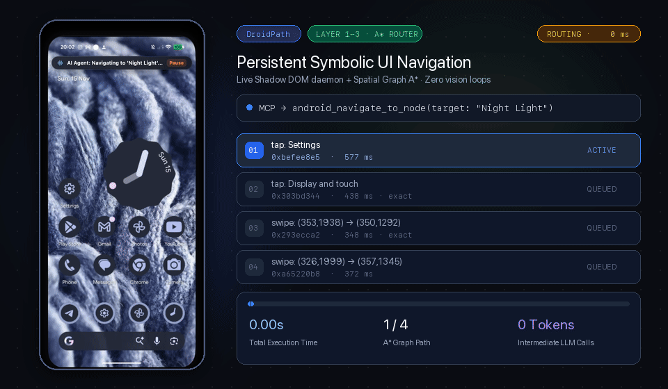
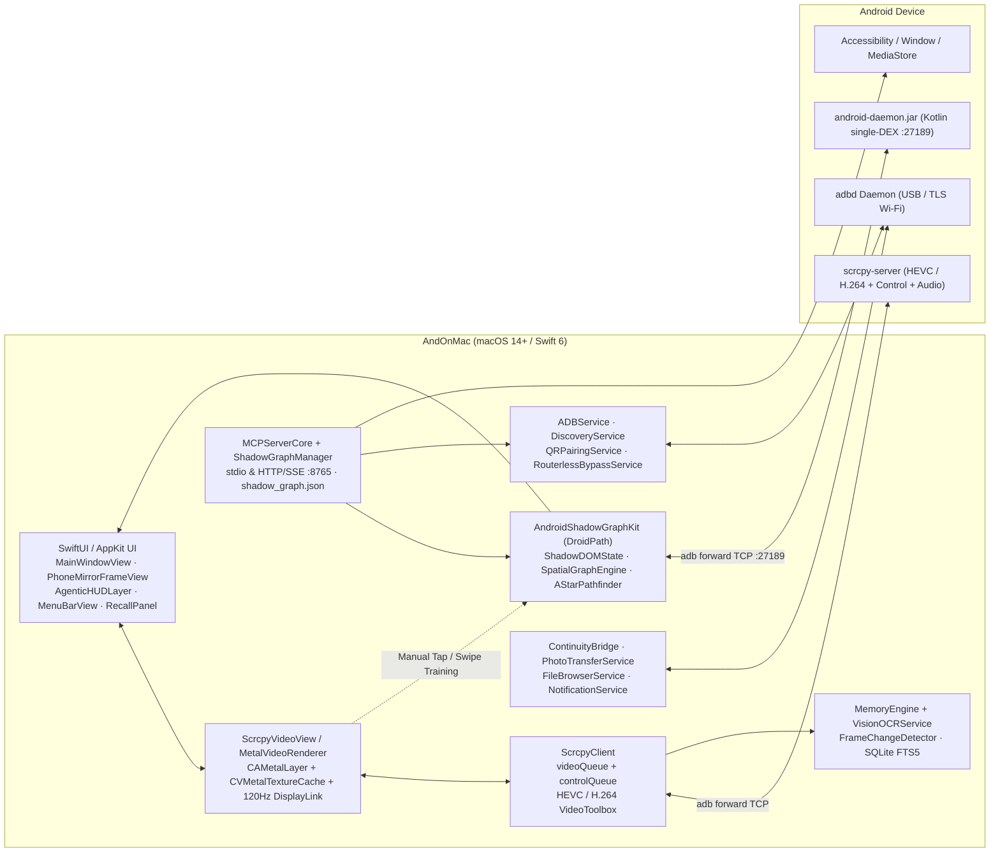

# AndOnMac — Full Feature Guide, MCP Reference & Architecture

[← Back to README](../README.md) | [Русская версия](FEATURES_RU.md)

---

## Core Mirroring & Performance

- **120Hz ProMotion Apple Silicon Engine:** Hardware-accelerated `HEVC` (`--max-fps=120`, 16 Mbps default) with automatic `H.264` fallback, zero-copy `CAMetalLayer` + `CVMetalTextureCache` + `120Hz CADisplayLink` rendering, macOS `latencyCritical` activity locking, 500ms wireless RTT/jitter probing with Adaptive Bitrate (ABR), and a toggleable **Metal Performance HUD**.
- **Device-Matched Floating Chassis (`PhoneFrameStyle`):** Auto-detects connected hardware and adapts bezel geometry, materials, and camera punch-hole placement for **Google Pixel**, **Samsung Galaxy S / Ultra**, **Xiaomi**, **Nothing Phone**, and **OnePlus**, plus Minimal and Borderless modes.
- **Standalone Android App Windows (Virtual Displays):** Search and launch any launchable Android app (both user-installed and pre-installed/system apps like YouTube, Chrome, and Settings) directly from the Menu Bar (`Launch Android App`) into its own native macOS window (`scrcpy --new-display --start-app=...`) while the physical phone screen stays off.
- **Persistent macOS Menu Bar Utility:** Control Center-style popover with live battery & USB/Wi-Fi badge, 1-click toggles (*Screen Off*, *Stay Awake*, *Audio Forwarding*, *Record Screen*), Bonjour Wi-Fi discovery, per-device FPS/bitrate/resolution profiles, and *Hide Dock Icon* mode.

---

## Connectivity & Wireless Bypass

- **QR-Code Wireless Pairing & Silent USB-to-Wi-Fi Handoff:** Native Android 11+ QR code pairing (`NWListener` + `_adb-tls-pairing._tcp` Bonjour + `CoreImage`), `dumpsys adb` `tls_port` extraction over USB, silent `adb tcpip 5555` promotion, and automatic wake-from-sleep reconnection.
- **Router-Isolation Bypass (Direct Hotspot & Bluetooth PAN):** Automatically detects AP/Client Isolation on public, university, or corporate Wi-Fi networks and offers a 1-click switch to **Direct Hotspot** or **Bluetooth PAN** (`192.168.44.1:5555`).

---

## Productivity, OCR & Semantic Screen Memory

- **Semantic Screen Memory ("Recall", `Cmd+Shift+F`):** Opt-in, 100% on-device screen history indexer. Every 10 seconds during mirroring, `FrameChangeDetector` hashes a 16×16 grayscale grid and skips static frames; changed screens are processed on Apple Silicon Neural Engine via Apple Vision `.accurate` OCR inside `autoreleasepool`, then indexed with foreground app package names and compressed 360px JPEG thumbnails in a local **SQLite FTS5** database (`~/Library/Application Support/AndOnMac/Memory/`) with automatic **7-day / 250 MB** retention.
- **On-Device Apple Vision Screen OCR (`Cmd+Shift+X`):** Press `Cmd+Shift+X` or click *"Grab Text from Screen"*, drag over any unselectable text on the mirrored phone display, and extract it straight into your Mac clipboard.
- **Background Apple Continuity Bridge:** Syncs copied Mac text and **copied images/screenshots** (`NSPasteboard` PNG/TIFF → `/sdcard/Pictures/AndOnMac/`) directly to Android even when the mirror window is closed.
- **Media Gallery (`Cmd+4`) & Android File Manager (`Cmd+5`):** Drag-and-drop recent photos/screenshots from `/sdcard/DCIM` and `/sdcard/Pictures` onto macOS or drop files/APKs into `/sdcard/Download/`; browse, upload, download, and manage device directories via `Cmd+5`.
- **Audio, Notifications & Input:** Forwards internal Android audio to Mac speakers via a race-free headless background helper (`SDL_MAC_BACKGROUND_APP=1`) with live `forwardAudio` toggling, mirrors companion notifications on TCP `:58241` to macOS Notification Center, and supports Cyrillic/Unicode input with **Send on Enter** (`Shift+Return` for newline).

---

## AI Agent Control (Built-in MCP Server)

AndOnMac ships with a zero-dependency **Model Context Protocol (MCP)** server (`protocolVersion: "2024-11-05"`) so Claude Desktop, Cursor, Windsurf, and local AI agents can inspect and control your Android device with a live visual HUD and an instant Menu Bar **Pause / Revoke Agent** kill-switch.

### Claude Desktop / Cursor Configuration (`stdio`)
Click **Copy MCP Config** in the AndOnMac Menu Bar, or add this to your `claude_desktop_config.json` / Cursor MCP config:

```json
{
  "mcpServers": {
    "andonmac": {
      "command": "/Applications/AndOnMac.app/Contents/MacOS/AndOnMac",
      "args": ["--mcp-stdio"]
    }
  }
}
```

You can also toggle **AI Agent Bridge (MCP)** in the Menu Bar to run the local HTTP/SSE server on `http://127.0.0.1:8765/sse`.

### Exposed Built-in Tools
- `android_navigate_to_node` (**Layer 3 Persistent A* Symbolic Router** — multi-step navigation across screens/menus via `SpatialGraphEngine` + `AStarPathfinder` with zero intermediate LLM screenshot loops; supports `auto_explore: true` cold-start fallback and `confirmed: true` for Human-in-the-Loop approval of hazardous actions)
- `android_explore_and_click` (**Dynamic Cold-Start Auto-Explore** — scores live Shadow DOM nodes, scrolls scrollable lists, taps, and records new edges into the Spatial Graph on the fly, or returns top-20 PII-scrubbed candidates)
- `android_list_devices` · `android_get_ui_tree` (live Shadow DOM / compact XML-to-JSON with `center_x`/`center_y`) · `android_screenshot` (auto-downscaled PNG)
- `android_tap_element` (coordinates or semantic `text`/`resource_id`/`content_desc`) · `android_swipe` · `android_type_text` · `android_keyevent` · `android_launch_app` · `android_get_notifications`

### Persistent A* Symbolic UI Router & 120Hz Agentic HUD ([DroidPath](https://github.com/V0val0x/DroidPath))
- **Layer 1 — Headless Shadow DOM Daemon (`android-daemon.jar`):** Zero-APK Kotlin single-DEX accessibility/window daemon launched via `app_process` strictly bound to `127.0.0.1` loopback over ADB TCP (`:27189`), idempotently synced via SHA-256 and automatically restarted with exponential backoff if killed by Android. Injects native `UiAutomation` `tap`/`swipe`/`keyevent` gestures directly over TCP `:27189` (with zero-fling 120Hz swipes and automatic `adb` fallback), masks `isPassword` / sensitive editable fields to `"***"` on-device before streaming, anchors `activePackage` to the foreground `TYPE_APPLICATION` window beneath transient `com.android.systemui` notifications, and broadcasts `SECURE_SCREEN_ACTIVE` / `SECURE_SCREEN_CLEARED` events on `FLAG_SECURE` or biometric prompts.
- **Layer 2 — Live Shadow DOM & Persistent Spatial Graph:** `ScreenLayoutHasher` normalizes volatile clocks, dates, e-commerce tokens (`<PRICE>`, `<ETA>`, `<WEIGHT>`), Luhn-validated payment card PANs (`<CARD>`), and contextual OTP/2FA codes (`<OTP>`), filters unanchored decorative `ImageView` banners, and masks `com.android.systemui` overlays before storage. `SpatialGraphEngine` classifies hazardous edges (`HazardousActionClassifier`), penalizes and self-prunes flaky edges via `consecutiveFailures`, compacts near-duplicate states at Jaccard `>= 0.90`, and persists transitions to `~/Library/Application Support/AndOnMac/shadow_graph.json` (100% compatible with cross-platform [DroidPath](https://github.com/V0val0x/DroidPath) on Windows, Linux, and macOS). Every manual tap/swipe inside `ScrcpyVideoView` passively trains new graph edges.
- **Layer 3 — `AStarPathfinder`, Auto-Recovery, HITL & `MacroExecutionEngine`:**
  - **Auto-Recovery & Router Resilience:** Detects forward-skipped nodes (`1 -> 3/4`), unwinds cross-package task-stack drift (`Back-to-Root` via up to 3 `KEYCODE_BACK` steps), performs `Smart Scroll-to-Selector` search scrolls inside scrollable containers when a target selector is off-screen, replans A* from off-path scroll states, runs `UniversalDismissDetector` to close non-destructive promo/splash popups (`"Close"`, `"Not now"`, `"X"`, etc.) without polluting the graph, and reflexively swipes away heads-up push banners that occlude target tap coordinates.
  - **Human-in-the-Loop (`requires_confirmation`):** Executes the safe prefix of a route and halts right before payment or destructive steps (`"Оплатить"`, `"Pay"`, `"Buy"`, `"Удалить"`, `"Delete"`, etc.), returning `status: "requires_confirmation"` until re-called with `confirmed: true`.
  - **`FLAG_SECURE` / Biometric Handoff:** Pauses execution (up to 60s default) without corrupting the graph when an empty `FLAG_SECURE` tree or biometric prompt appears, then automatically resumes upon manual unlock.
  - **LLM Onboarding Rules:** Includes pre-configured `.cursorrules`, `CLAUDE.md`, `GEMINI.md`, and `docs/system_prompt.md` instructing MCP agents to prefer `android_navigate_to_node` / `android_explore_and_click` over `android_screenshot` and respect HITL/`FLAG_SECURE` guardrails.
  - **3-Color 120Hz `AgenticHUDLayer` Telemetry:** **Red** (autonomous step execution & directional swipe vectors), **Yellow** (persistent reticle awaiting HITL confirmation or user text), **Blue** (persistent centered indicator awaiting biometrics / `FLAG_SECURE` unlock).
- **Visual-to-MCP Studio & Self-Healing Macros (`Cmd+Shift+M`):** Capture UI elements and build parameterized `{{variable}}` macros with 3-tier Vision OCR self-healing and live reload in the **MCP Tool Hub**.



**Example Prompts:**
- *"Check my Android notifications for the latest 2FA code and paste it here."*
- *"Open WhatsApp on my phone and reply 'On my way!' to Alex."*
- *"Take a screenshot of my Pixel and explain what's blocking the checkout screen."*

---

## Keyboard Shortcuts & Gestures

| Shortcut | Action |
| :--- | :--- |
| `Cmd + 1` / Swipe up from bottom bar | Home Screen (`KEYCODE_HOME`) |
| `Cmd + 2` / Swipe up and hold | App Switcher (`KEYCODE_APP_SWITCH`) |
| `Cmd + 3` | Notification Shade (`KEYCODE_NOTIFICATION`) |
| `Cmd + 4` | Toggle Photo & Media Transfer Drawer |
| `Cmd + 5` | Open Android File Manager |
| `Cmd + Shift + X` | Grab Text from Screen (Apple Vision OCR) |
| `Cmd + Shift + F` | Recall Screen Memory (Spotlight Search) |
| `Cmd + Shift + M` | Visual-to-MCP Capture & Self-Healing Macro Studio |
| `Cmd + Backspace` / `Esc` / Right-Click | Back (`KEYCODE_BACK`) |
| `Cmd + P` | Power / Lock / Wake Screen |
| `Cmd + 0` / `Cmd + +` / `Cmd + -` | Window Scale (100% / 125% / 75%) |
| `Cmd + Shift + R` | Reset ADB & Recover USB |
| `Cmd + W` | Stop Mirroring / Close Window |

---

## Security & ADB Privacy Model

AndOnMac communicates **100% locally** between your Mac and your Android device — zero cloud servers, zero analytics, zero telemetry:

- **Explicit Phone Authorization (RSA / TLS):** Both USB Debugging and Android 11+ Wireless Debugging (`_adb-tls-pairing._tcp` / `_adb-tls-connect._tcp`) require unlocking the phone and approving your Mac's RSA fingerprint.
- **No Shell / Flag Injection:** Device serials, package names, and `host:port` endpoints are strictly validated before invoking `adb`, and subprocesses pass argument arrays without shell interpolation.
- **Accidental Data-Loss & Traversal Protection:** File operations reject `..` traversal, null bytes, and destructive deletions on protected Android roots (`/`, `/sdcard`, `/sdcard/DCIM`, `/sdcard/Download`, `/system`).
- **Privacy by Design & Bounded Local Listeners:** `android-daemon.jar` redacts `isPassword` and sensitive editable fields to `"***"` on-device over `127.0.0.1` loopback, and `ScreenLayoutHasher` scrubs Luhn-validated `<CARD>` PANs and contextual `<OTP>` codes before persistence to `shadow_graph.json`. The notification listener (`:58241`) rejects payloads over 64 KB, the HTTP MCP server enforces loopback-only `Host`/`Origin` and Bearer auth checks, video buffers are capped at 16 MB, photo cache prunes at 200 MB, and Screen Memory prunes at 7 days / 250 MB.

---

## Architecture Overview


