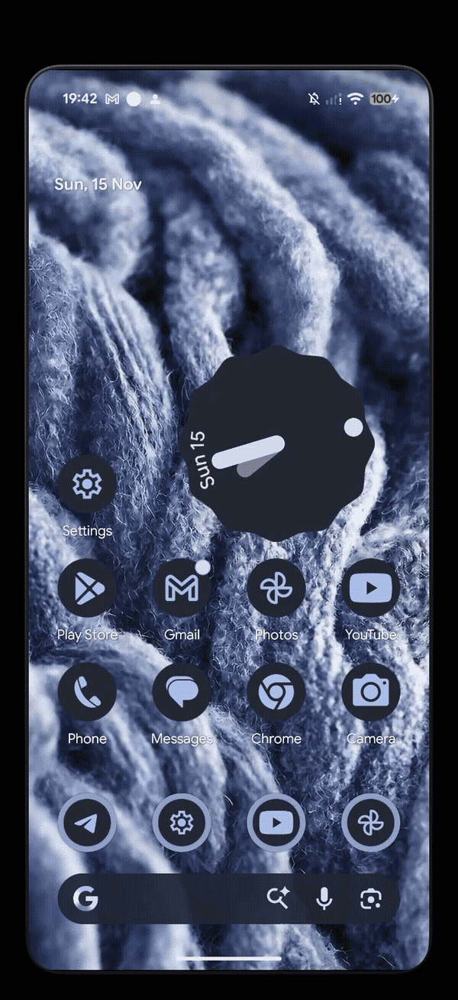
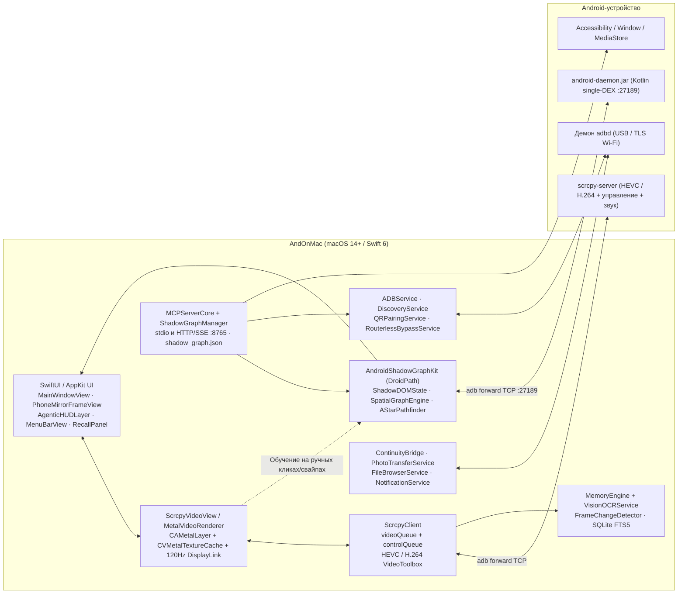

# AndOnMac — Подробное руководство, MCP и архитектура

[← Назад к README](../README_RU.md) | [English Version](FEATURES.md)

---

## Трансляция и производительность

- **Движок 120Hz ProMotion для Apple Silicon:** аппаратное декодирование `HEVC` (`--max-fps=120`, 16 Мбит/с по умолчанию) с автоматическим переходом на `H.264`, zero-copy вывод через `CAMetalLayer` + `CVMetalTextureCache` + `120Hz CADisplayLink`, приоритет macOS `latencyCritical`, адаптивный битрейт (ABR) по замерам RTT/jitter и отключаемый **Metal Performance HUD**.
- **Адаптивная рамка смартфона (`PhoneFrameStyle`):** автоматическое определение модели (**Google Pixel**, **Samsung Galaxy S / Ultra**, **Xiaomi**, **Nothing Phone**, **OnePlus**) или минималистичный/безрамочный режим.
- **Отдельные окна для Android-приложений (Virtual Displays):** поиск и запуск любых запускаемых приложений Android (включая системные/предустановленные вроде YouTube, Chrome и Настроек) прямо из строки меню (`Запуск приложения Android`) в отдельном окне macOS (`scrcpy --new-display --start-app=...`) при выключенном экране телефона.
- **Постоянная утилита в строке меню (Menu Bar):** поповер в стиле Пункта управления с индикатором заряда и USB/Wi-Fi, переключателями в 1 клик (*Экран выкл.*, *Не засыпать*, *Звук*, *Запись экрана*), поиском устройств по Bonjour mDNS, профилями качества по устройствам и режимом *Скрыть иконку из Dock*.

---

## Подключение и обход изоляции сети

- **QR-сопряжение и автопереход USB → Wi-Fi:** нативное сопряжение Android 11+ по QR-коду (`NWListener` + `_adb-tls-pairing._tcp` Bonjour + `CoreImage`), извлечение `tls_port` из `dumpsys adb` по кабелю, тихий перевод USB → `adb tcpip 5555` и автопереподключение после сна Mac.
- **Обход изоляции роутера (Direct Hotspot и Bluetooth PAN):** автоматически определяет AP/Client Isolation в публичных, университетских или корпоративных Wi-Fi сетях и предлагает переключение в 1 клик на **Direct Hotspot** или **Bluetooth PAN** (`192.168.44.1:5555`).

---

## Продуктивность, Vision OCR и Semantic Screen Memory

- **Semantic Screen Memory («Recall», `Cmd+Shift+F`):** опциональная (opt-in) и полностью локальная память экрана. Во время трансляции каждые 10 секунд `FrameChangeDetector` вычисляет хеш сетки 16×16 и пропускает статичные кадры; при изменениях запускается локальный Apple Vision `.accurate` OCR на Neural Engine внутри `autoreleasepool`, а текст, пакет активного приложения и сжатые JPEG-миниатюры (360px) сохраняются в **SQLite FTS5** (`~/Library/Application Support/AndOnMac/Memory/`) с автоудалением старше **7 дней** и лимитом **250 МБ**.
- **Локальный Apple Vision OCR (`Cmd+Shift+X`):** нажмите `Cmd+Shift+X` или *«Распознать текст с экрана»*, выделите любую область на экране смартфона и скопируйте текст прямо в буфер обмена Mac.
- **Фоновый Continuity Bridge:** синхронизирует скопированный на Mac текст и **изображения/скриншоты** (`NSPasteboard` PNG/TIFF → `/sdcard/Pictures/AndOnMac/`) даже при закрытом окне зеркалирования.
- **Медиатека (`Cmd+4`) и файловый менеджер (`Cmd+5`):** перетаскивание фото и скриншотов из `/sdcard/DCIM` и `/sdcard/Pictures` на рабочий стол Mac и загрузка файлов/APK в `/sdcard/Download/`, а также полноценный просмотр и управление папками Android (`Cmd+5`).
- **Звук, уведомления и ввод:** передача системного звука Android на динамики Mac через синхронизированный фоновый аудио-помощник (`SDL_MAC_BACKGROUND_APP=1`) с мгновенным переключением `forwardAudio` на лету, нативные уведомления macOS через TCP `:58241`, ввод кириллицы/Unicode и отправка по `Enter` (`Shift+Return` для новой строки).

---

## Управление ИИ-агентами (встроенный MCP-сервер)

AndOnMac включает встроенный **Model Context Protocol (MCP)** сервер без внешних зависимостей (`protocolVersion: "2024-11-05"`), позволяющий Claude Desktop, Cursor, Windsurf и локальным ИИ-агентам анализировать экран и управлять смартфоном с живым HUD-индикатором и кнопкой **Пауза / Отзыв агента** в строке меню.

### Настройка для Claude Desktop / Cursor (`stdio`)
Нажмите **Копировать MCP Config** в строке меню AndOnMac или добавьте в `claude_desktop_config.json` / настройки MCP в Cursor:

```json
{
  "mcpServers": {
    "andonmac": {
      "command": "/Applications/AndOnMac.app/Contents/MacOS/AndOnMac",
      "args": ["--mcp-stdio"]
    }
  }
}
```

Также можно включить **AI Agent Bridge (MCP)** в строке меню для запуска локального HTTP/SSE сервера на `http://127.0.0.1:8765/sse`.

### Встроенные MCP-инструменты
- `android_navigate_to_node` (**Layer 3 персистентный A* символьный UI-роутер** — многошаговая навигация между экранами и меню через `SpatialGraphEngine` + `AStarPathfinder` без промежуточных циклов скриншотов и LLM; поддерживает `confirmed: true` для Human-in-the-Loop подтверждения опасных действий)
- `android_list_devices` · `android_get_ui_tree` (живой Shadow DOM / компактный XML→JSON с `center_x`/`center_y`) · `android_screenshot` (сжатый PNG)
- `android_tap_element` (по координатам или `text`/`resource_id`/`content_desc`) · `android_swipe` · `android_type_text` · `android_keyevent` · `android_launch_app` · `android_get_notifications`

### Персистентный A* UI-роутер и 120Hz Agentic HUD ([DroidPath](https://github.com/V0val0x/DroidPath))
- **Layer 1 — Headless Shadow DOM демон (`android-daemon.jar`):** single-DEX Kotlin-демон без установки APK (`app_process` через ADB TCP `:27189`), с идемпотентным SHA-256 деплоем и автоперезапуском при обрыве связи. Привязывает `activePackage` к основному окну приложения (`TYPE_APPLICATION`) под всплывающими уведомлениями `com.android.systemui` и транслирует события `SECURE_SCREEN_ACTIVE` / `SECURE_SCREEN_CLEARED` при `FLAG_SECURE` и биометрии.
- **Layer 2 — Live Shadow DOM и персистентный Spatial Graph:** `ScreenLayoutHasher` канонизирует динамические часы, даты и e-commerce токены (`<PRICE>`, `<ETA>`, `<WEIGHT>`), исключает декоративные `ImageView` баннеры без `resourceId` и маскирует оверлеи `com.android.systemui`. `SpatialGraphEngine` помечает опасные рёбра (`HazardousActionClassifier`), объединяет дубликаты экранов при Jaccard `>= 0.90` и сохраняет граф в `~/Library/Application Support/AndOnMac/shadow_graph.json` (100% совместим с кроссплатформенным [DroidPath](https://github.com/V0val0x/DroidPath) на Windows, Linux и macOS). Каждый ручной клик и свайп в `ScrcpyVideoView` пассивно обучает новые рёбра графа.
- **Layer 3 — `AStarPathfinder`, Auto-Recovery, HITL и `MacroExecutionEngine`:**
  - **Auto-Recovery:** распознаёт пропуск промежуточных нод (`1 -> 3/4`), перестраивает A* при смещении скролла, закрывает неинвазивные промо-попапы через `UniversalDismissDetector` (`«Закрыть»`, `«Не сейчас»`, `«X»` и т.д.) без загрязнения графа и рефлекторно смахивает вверх пуш-баннеры, перекрывающие целевую кнопку.
  - **Human-in-the-Loop (`requires_confirmation`):** проходит безопасный префикс маршрута и останавливается строго перед оплатой или удалением (`«Оплатить»`, `«Pay»`, `«Buy»`, `«Удалить»`, `«Delete»`), возвращая `status: "requires_confirmation"` до повторного вызова с `confirmed: true`.
  - **`FLAG_SECURE` / Биометрия:** ставит выполнение на паузу (до 60 с по умолчанию) без записи пустых узлов при появлении защищённого экрана или биометрического промпта и автоматически продолжает маршрут после разблокировки.
  - **Трёхцветная 120Hz телеметрия `AgenticHUDLayer`:** **Красный** (автономная работа и векторы свайпов), **Жёлтый** (постоянный прицел ожидания подтверждения HITL или ввода текста), **Синий** (индикатор ожидания биометрии / `FLAG_SECURE`).
- **Visual-to-MCP Studio и самовосстанавливающиеся макросы (`Cmd+Shift+M`):** захват элементов с экрана, параметризованные макросы `{{variable}}`, 3-уровневый Vision OCR Self-Healing и LiveReload в **MCP Tool Hub**.



**Примеры запросов:**
- *«Проверь уведомления на Android и вставь последний код 2FA.»*
- *«Открой WhatsApp и ответь Алексу "Уже выезжаю!".»*
- *«Сделай скриншот Pixel и посмотри, что мешает оформить заказ.»*

---

## Горячие клавиши и жесты

| Сочетание | Действие |
| :--- | :--- |
| `Cmd + 1` / Свайп вверх от нижней панели | Домашний экран (`KEYCODE_HOME`) |
| `Cmd + 2` / Свайп вверх с удержанием | Недавние приложения (`KEYCODE_APP_SWITCH`) |
| `Cmd + 3` | Шторка уведомлений (`KEYCODE_NOTIFICATION`) |
| `Cmd + 4` | Открыть / скрыть медиатеку и перенос фото |
| `Cmd + 5` | Файловый менеджер Android |
| `Cmd + Shift + X` | Распознать текст с экрана (Apple Vision OCR) |
| `Cmd + Shift + F` | Поиск по истории экрана (Recall) |
| `Cmd + Shift + M` | Visual-to-MCP Studio и запись макросов |
| `Cmd + Backspace` / `Esc` / ПКМ | Назад (`KEYCODE_BACK`) |
| `Cmd + P` | Блокировка / Включение экрана |
| `Cmd + 0` / `Cmd + +` / `Cmd + -` | Масштаб окна (100% / 125% / 75%) |
| `Cmd + Shift + R` | Сброс ADB и восстановление USB |
| `Cmd + W` | Остановить трансляцию / Закрыть окно |

---

## Безопасность и приватность ADB

AndOnMac работает **полностью локально** между Mac и Android — без облачных серверов, аналитики и телеметрии:

- **Подтверждение устройством (RSA / TLS):** и отладка по USB, и беспроводная отладка Android 11+ (`_adb-tls-pairing._tcp` / `_adb-tls-connect._tcp`) требуют разблокировать телефон и подтвердить RSA-ключ Mac.
- **Защита от инъекций:** серийные номера, имена пакетов и адреса `host:port` строго валидируются до вызова `adb`, а подпроцессы запускаются массивом аргументов без shell-интерполяции.
- **Защита от случайной потери данных:** файловый менеджер блокирует path traversal (`..`), нулевые байты и удаление системных корней (`/`, `/sdcard`, `/sdcard/DCIM`, `/sdcard/Download`, `/system`).
- **Ограничения локальных буферов:** сервер уведомлений (`:58241`) отклоняет пакеты > 64 КБ, HTTP MCP-сервер проверяет loopback `Host`/`Origin` и Bearer-токен, видео-буфер ограничен 16 МБ, кэш фото — 200 МБ, а Screen Memory — 7 днями / 250 МБ.

---

## Архитектура


